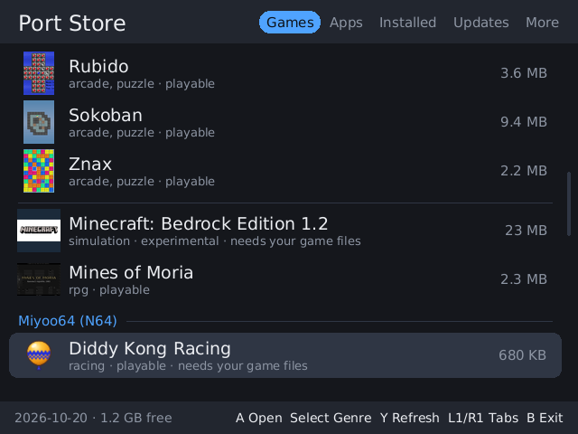
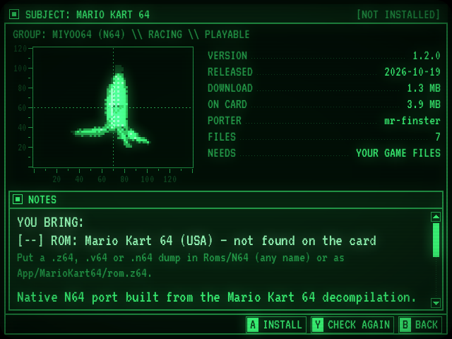
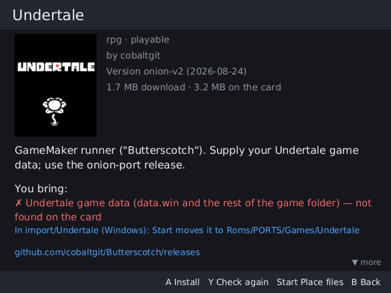

# Port Store for Miyoo Mini

Install, update and remove ports right on a Miyoo Mini, Mini Plus, Mini v4 or Mini Flip running
[OnionOS](https://github.com/OnionUI/Onion): no computer, no copying folders by hand.

 

- **62 ports and apps**, including all 12 native N64 games of
  [Miyoo64](https://github.com/mr-finster/miyoo64) (Mario Kart 64, Super Mario 64, Ocarina
  of Time, GoldenEye 007…), Undertale, Fallout 1 and 2, Half-Life, Tomb Raider, OpenRCT2 and
  apps like Moonlight, Syncthing or Better WiFi.
- **Games** and **Apps** tabs, genres, pictures, newest first; install several ports at once.
- Games go to their own system, **Games → MiyooPorts**, next to your consoles.
- **Updates** of the ports, and of Port Store itself, are offered as soon as their authors
  publish them; the number of updates shows under Port Store's name in Apps.
- Games that need **your own files** (a ROM, the game's data) say what to put where; copy them
  into one folder as they are and Port Store puts them in place.
- Works **without Wi-Fi** too, with files brought on a computer.
- Everything is downloaded from the authors' own GitHub releases and checked against the
  catalog's SHA-256. Port Store hosts no games.
- Safe with your card: files are unpacked and checked before anything is put in place, and
  updates and removals touch only what Port Store put there: never saves, settings, your game
  files or another port's files.

## Install

1. Download **`PortStore-<version>.zip`** from
   [Releases](https://github.com/l0st0npl4net/PortStore-Catalog-MiyooMini/releases).
2. Unzip it to the **root of the SD card**. It contains `App/PortStore`: if asked, merge
   with the `App` folder that is already there.
3. On the Mini: **Apps → Port Store**.

Needs Wi-Fi (Mini Plus, Mini Flip) and the right date and time (Clock app) for secure
downloads; without Wi-Fi, see [below](#without-wi-fi). On the Mini v4 and Flip, Port Store uses
the whole 752×560 screen (not yet tried on those devices: reports welcome).

**Already have Port Store?** It updates itself (see [Updates](#updates)). Port Store 0.3.0 or
0.4.0 put on the card by unzipping a release does not see its own updates: unzip the newest
release over it once.

## Use

| Button | |
|---|---|
| D-pad | move; Left / Right: a page |
| L1 / R1 | tabs: Games, Apps, Installed, Updates, More |
| A | open a port; on its page: install, update or reinstall |
| X | list: mark a port (Start installs the marked ones); page: remove |
| Start | list: install the marked ports, one after another; page: move your files found in `import` into place |
| Select | Games: next genre; Updates: update all |
| R2 | newest releases first / A to Z |
| Y | list: download the newest catalog again; page: check your files again |
| B | back; on the list: quit |

- **Games** lists the games, collections such as Miyoo64 under their own heading; **Apps** the
  apps; **Installed** what Port Store installed; **More** ports Port Store cannot install yet,
  with a link to their page.
- A port's page shows its picture, version, size, what it is, and what you bring for it, checked
  on the card: ✓ found, ✗ missing, ! another version of the game's ROM.
- **Several at once:** mark ports with X in the list, then Start installs them one after
  another, and tells at the end what was installed, what not and why.
- **Removing** a port takes away the files Port Store put on the card. Your saves, settings and
  game files stay.

## MiyooPorts

Games installed by Port Store are in **Games → MiyooPorts**, a system of their own next to your
consoles, with its own icon (an icon pack can bring its own `miyooports.png`):

- every game is there, whatever way its author packed it: for OnionOS's Ports, or as an app
  (Minecraft, Petals); **Apps keeps only apps**;
- each game once: the releases' own Ports shortcuts are kept out of sight, and OnionOS's
  **Ports** entry keeps its own games;
- a game that needs your files shows right away; started without them, it says what is missing
  and where it goes;
- ports that start through OnionOS's *Ports Collection* get it added by themselves (as Package
  Manager would).

Games installed with Port Store 0.3 move from Ports and Apps into MiyooPorts at the first start
of a newer Port Store; saves and game files stay where they are.

## Your game files



Ports like Undertale, Fallout, Half-Life, Captain Claw or OpenRCT2 need files from your own copy
of the game, and the Miyoo64 games a ROM.

1. Copy them from your computer into **`App/PortStore/import`** on the card, as they are: whole
   folders ("Undertale (Windows)", "RollerCoaster Tycoon 2", Half-Life's folder with `valve` in
   it), N64 ROMs loose (`.z64`, `.v64`, `.n64`, any name).
2. Open the port's page in Port Store: under "You bring" it says what it found in `import` and
   where it goes.
3. Press **Start**: the files are moved into place (on the card itself, so even big games are
   quick), and the page shows them as found.

A ROM is told by its checksum, so only the version the port is made for is taken. You can also
put the files in place yourself: the page says where (Y checks again).

## Updates

- The catalog is built again every day from the ports' releases, and Port Store downloads it
  each time it starts. A port with a newer release shows in the **Updates** tab; **Select**
  there updates them all.
- The number of updates shows under Port Store's name in **Apps** (after Port Store has run
  once since they came out).
- A new **Port Store** is offered as soon as it starts: it updates itself and starts again.
- An update replaces the port's files and removes those the new version dropped. Saves,
  settings and your game files stay.

## Without Wi-Fi

The catalog that comes with Port Store is the one of its release; newer catalogs and the
ports' files are brought on a computer.

1. **Ask Port Store what it needs.** Pick the ports you want (X marks several, Start
   installs them) or open the Updates tab and press Select. Without a connection Port Store
   says so and writes `App/PortStore/downloads/to-download.txt`: the address of the newest
   catalog, then a name and an address for each file:
   ```
   Newest catalog, saved here as index.json:
     https://l0st0npl4net.github.io/PortStore-Catalog-MiyooMini/index.json

   File: MarioKart64-miyoo.zip
     https://github.com/mr-finster/miyoo64/releases/download/1.2.0/MarioKart64-miyoo.zip
   ```
2. **Download them on a computer** (card in a card reader, or copy them over later) into
   `App/PortStore/downloads`, each under the name given. Save the catalog as `index.json`.
3. **Back on the Mini**, open Port Store: it uses the newest catalog it has (the one it came
   with, the one it downloaded, or `downloads/index.json`), so the Updates tab shows what is
   new. Install as usual: the file is taken from `downloads` and checked against the
   catalog's checksum. A file listed but not brought yet stays in `to-download.txt`.

**Updates** the same way: bring the newest `index.json` first (step 2), and the Updates tab
lists what changed; Select there, then the files it asks for.

Files stay in `downloads` after installing: delete them to free space.

## Troubleshooting

- Port Store writes `App/PortStore/cache/portstore.log`; OnionOS's import of ports writes
  `Roms/PORTS/import.log`.
- "The secure connection failed": check the date and time (Clock app).
- The footer says "offline": the catalog could not be downloaded (Wi-Fi off or out of reach);
  Port Store works with the catalog it has.

## Adding a port

A port gets in with a recipe in a pull request, checked automatically: see
[CONTRIBUTING.md](CONTRIBUTING.md).

## Thanks

- [mr-finster/miyoo64](https://github.com/mr-finster/miyoo64): the N64 decompilation ports
  for the Mini.
- [Producdevity/MiyooMini-Ports](https://github.com/Producdevity/MiyooMini-Ports): the
  catalog of Mini ports; Port Store takes its categories, status, notes and pictures, and
  lists its other entries under More.
- Every port's author, whose releases Port Store installs, and
  [OnionOS](https://github.com/OnionUI/Onion).

## License

Port Store and its recipes are under the [MIT License](LICENSE). The ports it installs keep
their authors' own licenses: Port Store does not host them, the Mini downloads each from its
author's release. The font, certificates and Rust crates it ships with have their own licenses,
in `App/PortStore/licenses`.

---

## How it works

The full map for developers (the catalog's GitHub Actions, the app's modules, building,
testing and releasing): [docs/DEVELOPMENT.md](docs/DEVELOPMENT.md).

- `recipes/` — one JSON file per port: which release file to take and what of it goes onto
  the SD card.
- `index/build.py` — builds `index.json` from the recipes: newest matching release, the
  file's SHA-256, its layout checked, the pictures made small. GitHub Actions runs it every
  day and when recipes change, and publishes the result on GitHub Pages.
- `app/` — Port Store itself (Rust, draws to the framebuffer, no SDL).

Only the ports' pictures are published with the index (`img/`: 48×48 for the list, up to
224×168 for a port's page), taken from the release (OnionOS's `Roms/PORTS/Imgs`, or an app's
`icon.png`) or else from the catalog's `image`. The build needs Pillow for them
(`pip install pillow`); without it the index is built without pictures.

### Recipes

```json
{
  "id": "n64-mario-kart-64",
  "name": "Mario Kart 64",
  "group": "Miyoo64 (N64)",
  "github": "mr-finster/miyoo64",
  "asset": "^MarioKart64-miyoo\\.zip$",
  "take": ["App/MarioKart64/", "Roms/PORTS/"],
  "skip": ["App/MarioKart64/config.json"],
  "needs": [{ "what": "ROM: Mario Kart 64 (USA)", "sha1": "579c…", "search": ["Roms/N64"], "n64": true }]
}
```

| Field | |
|---|---|
| `id` | unique, also the name of the install record on the card |
| `catalog` | the entry's `name` in MiyooMini-Ports `ports.json`: its metadata is used |
| `name`, `group`, `categories`, `status`, `assets`, `porter`, `about`, `url`, `image` | override or replace catalog metadata. Category `app` puts a port under Apps, the rest under Games; ports of a `group` are listed together under its heading |
| `github`, `asset`, `tag`, `prerelease` | release search: repository, file name regex, tag regex, allow pre-releases |
| `strip` | prefix taken off every member (default: a single wrapper folder that is not a card folder) |
| `take` | path prefixes (from the card's root) that are installed; default `App/`, `Roms/PORTS/` |
| `into` | a folder the whole archive goes into (an app zipped without its `App/<Name>/`) |
| `map` | `[from, to]` prefixes for releases laid out otherwise (`["Games/", "Roms/PORTS/Games/"]`); the first match wins, the rest is left out |
| `skip` | card paths not installed though the release has them |
| `shortcut` | `{ "launch": "Roms/PORTS/Games/X/launch.sh", "image": "Roms/PORTS/Imgs/X.png" }`: how the game starts from MiyooPorts, when its own shortcut does not do (OpenRCT2's) |
| `keep` | files of the release the user changes (settings): installed once, then never overwritten or removed (prefix if it ends in `/`). Files the release does not have (saves, game data) are never touched anyway |
| `needs` | what the user brings: `what`, `hint`, `check` (paths that exist once it is in place), or a ROM by `sha1` looked for in `search` (`n64`: any byte order; `title`: header title, to tell another version of the same game). Game data checks are also read from the release's OnionOS shortcuts |

Releases may be zip, tar, tar.gz or 7z (the build reads 7z with py7zr, the device unpacks it
with OnionOS's 7-Zip). A recipe failing in two builds in a row opens (or updates) the issue
"Recipes failing"; it closes by itself once they build again.

Build the index locally (without `GITHUB_TOKEN`, releases are read from github.com pages):

```sh
python3 index/build.py --out site/index.json --cache .cache
```

### Building Port Store

Rust 1.96 (`app/rust-toolchain.toml`) and the Miyoo Mini toolchain (GCC 8.3, glibc 2.28),
set up as in `../slot-mini/tools/mini/env.sh`.

```sh
tools/package.sh out https://l0st0npl4net.github.io/PortStore-Catalog-MiyooMini/index.json
# out/App/PortStore, as on the card
tools/release.sh https://l0st0npl4net.github.io/PortStore-Catalog-MiyooMini/index.json
# out/PortStore-<version>.zip, for a release tagged v<version> (version from app/Cargo.toml)
```

Port Store is in its own catalog (`recipes/portstore.json`), so a new release reaches the
devices as an update.

On the card: `App/PortStore/settings.json` (catalog address), `installed/` (what Port Store
put where, per port), `downloads/` (release files brought on a computer), `cache/` (log, last
catalog, pictures, ROM checksums).

Install is file by file: unpacked into a staging folder first, then moved into place; updates
remove only files the new version dropped; removal leaves `keep` files and anything Port
Store did not put there.

**MiyooPorts** is a system of Port Store's (`Emu/MiyooPorts`, icon
`Icons/Default/miyooports.png`: an icon pack may bring its own `miyooports.png`). Each game
gets a launcher, `Roms/MiyooPorts/<Game>.sh`, with its picture in `Roms/MiyooPorts/Imgs`
(the release's own for Ports, else the catalog's):

- a release for Ports Collection: its shortcuts, pictures and manuals go to
  `Roms/MiyooPorts/.ports` (hidden from the lists), and the launcher runs the shortcut through
  Ports Collection's `Emu/PORTS/launch.sh`; `Roms/PORTS/Games` holds the game as before;
- a game released as an app: its `App/<Name>/config.json` (its entry in Apps) is read for how
  it starts and not installed; the launcher starts it in its folder;
- before the game, the launcher checks the files the user brings (`needs` with `check`, as
  `~Import ports` would) and says on screen what is missing and where it goes.

On start, installed ports are brought in line with how Port Store installs them now (ports of
Port Store 0.3 move from Ports and Apps into MiyooPorts; files the catalog now skips go).

Commands for testing (also off the device, with `PORTSTORE_CARD`, `PORTSTORE_HOME`):
`portstore list | install ID | remove ID | needs ID | refresh | shots DIR [ID…]`.
